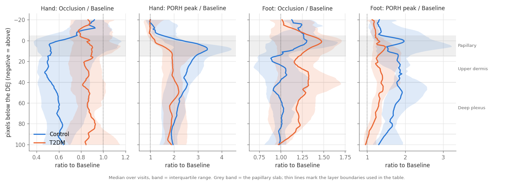
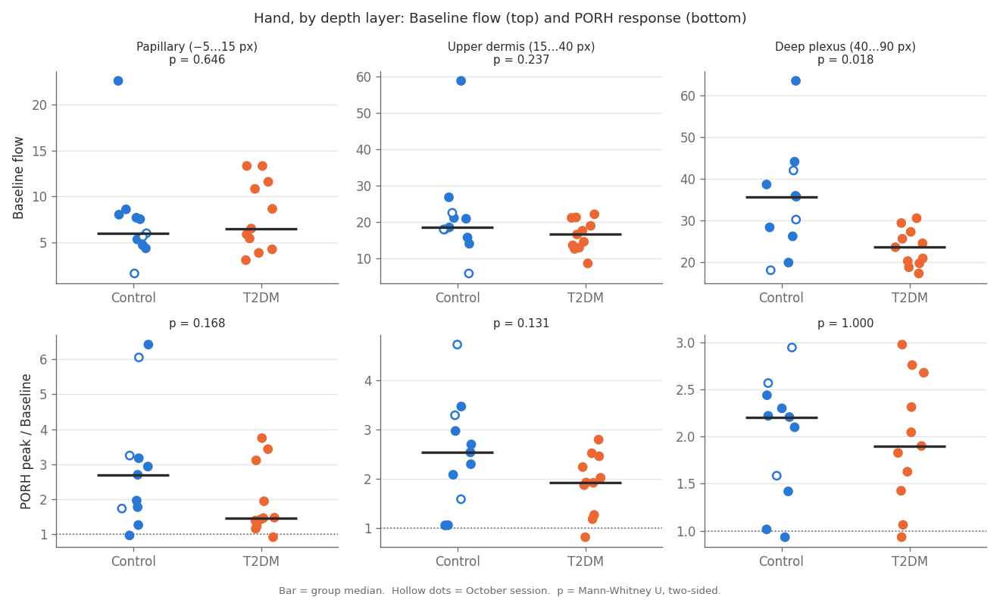
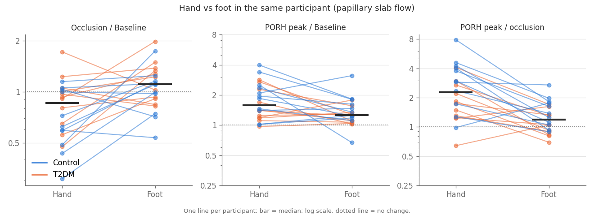
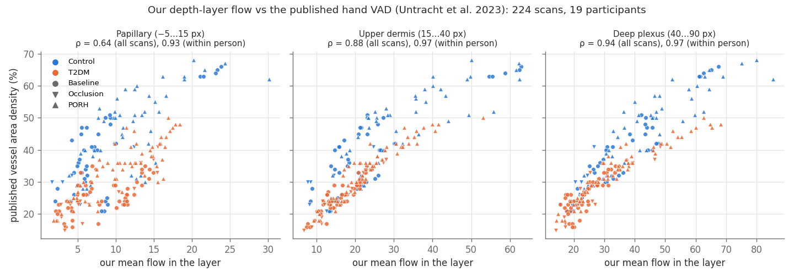

# T2DM vs controls: Baseline flow and PORH response

*Run finished 2026-11-12. Figures made by `src/report_study_groups.py` from the
results in `outputs/porh_time_course/study_groups/slab_-5_15/`.*

## In short

1. **Foot Baseline flow is higher in T2DM than in controls**: median slab flow
   29.7 vs 19.5 (p = 0.001). This is the only clear group difference. It holds
   with the October session removed. However, **2 of the 3 highest T2DM feet have
   image problems**, so it needs a quality check before it goes in the article.
2. **Hands:** Baseline flow is the same in both groups. Controls show a bigger PORH
   rise (×1.95 vs ×1.40), but the difference is **not significant** (p = 0.25).
3. **Feet:** the PORH response is weak in both groups. Foot flow often *rises*
   during occlusion, even though the cuff was on the calf at 200 mmHg (from the
   paper). Until that's explained, foot PORH can't be used to compare the groups.
4. **Deeper layers (section 3) show the same pattern more clearly.** In T2DM
   hands, flow in the upper dermis and the deep plexus hardly drops during
   occlusion (about 0.9 of Baseline, against about 0.5 in controls, p ≈ 0.03).
   T2DM hands also have less deep-plexus flow at rest (p = 0.018). The controls'
   PORH overshoot is concentrated right at the papillary loops, and T2DM hands
   lack that peak.
5. **In the foot, controls do react at depth** (deep-plexus PORH ×1.73 vs ×1.21 in
   T2DM, p = 0.057). So the foot occlusion may work better than the papillary slab
   suggested.
6. **Hands react much more strongly than feet in the same person (section 4).**
   Hands show a drop during occlusion and a ×2.3 overshoot (peak / occlusion);
   feet show no drop and ×1.2. In controls the foot also has *lower* resting flow
   than the hand (10 of 11 people), but in T2DM it doesn't. This is a
   within-person version of the high T2DM foot flow in point 1.
7. **The pipeline matches the published analysis (section 5).** The data comes
   from Untracht et al. (Sci Rep 2023). Their per-scan hand vessel area density
   tracks our deep-layer flow almost exactly (ρ = 0.94 over 224 scans). It also
   shows the same T2DM difference in the hand: lower at rest (p = 0.005) and a
   smaller occlusion drop.

## What was run

| | |
|---|---|
| Participants | 11 T2DM, 11 controls (the article's study groups; mean age 60.5 vs 60.4) |
| Sites | Hand and foot (hallux or instep), one visit per site |
| Scans | 506 (44 visits × about 5 Baseline + 1 occlusion + 6 PORH) |
| Sessions | All T2DM scanned in May 2021; 3 controls (CA, JA, TL) only in October 2020 |
| Measure | **Slab flow** = mean brightness of the MIP of the slab from 5 px above to 15 px below the DEJ; plus the **loop count** (the thesis loop detector: threshold 75, minimum size 30, circularity 0.45; not yet validated against loops counted by eye), and (section 3) average flow per depth layer |
| Statistics | Mann-Whitney U, two-sided, one value per participant and site. No correction for multiple tests. |

*PORH = post-occlusive reactive hyperaemia: the overshoot in blood flow after the
cuff is released.*

---

## 1. Baseline flow


- **Hand:** the two groups overlap completely (26.9 vs 26.3).
- **Foot:** T2DM is clearly higher (29.7 vs 19.5).
  - Ranked by foot flow, the 7 lowest are all controls, and 6 of the 7 highest are
    T2DM.
  - The loop count agrees: 570 vs 350 (p = 0.003).
  - It is **not the October session**: with the 3 October controls removed it is
    29.7 vs 20.2 (p = 0.004).
  - It is **not where on the foot we scanned**: T2DM is higher on both the hallux
    (31.1 vs 18.3) and the instep (39.8 vs 14.7).
  - It is **not skin thickness**: median epidermis 33 vs 32 px.

**A possible biological explanation:** neuropathy damages the sympathetic nerves
that keep skin vessels constricted. The diabetic foot can therefore run warm with
high resting blood flow, partly through shunting past the capillaries. If the
finding holds, it would be a meaningful result.

### But look at the images behind the extremes


The top row shows the en-face MIPs, all on the same brightness scale. The bottom
row shows the middle B-scan, with the DEJ the model found in cyan.

- **The low controls (RM, CA, CS)** look like genuinely low flow. The tissue and
  DEJ look fine, and flow (red) only appears deeper down.
- **DH (T2DM):** vertical red streaks run through the air *above* the skin. That
  is motion or noise artefact, and it adds "flow" to the slab.
- **RH (T2DM):** the skin surface is cut off at the top of the image, and the DEJ
  is missing in 14% of columns. The dark bands on the left of the MIP come from
  that.
- **JF (T2DM):** the MIP shows a network of larger vessels rather than loop dots.
  Either larger vessels sit very close to the surface (which could be real
  biology), or the slab reaches the deeper plexus.

**So the foot result is promising but not yet safe.** Before trusting it we need a
scan-quality check (artefact above the skin, cut-off surface, missing DEJ), and to
re-test the difference with poor scans removed.

### Flow vs depth


Each curve shows the average flow at each depth relative to the DEJ. The grey band
is the slab.

- **Foot:** T2DM has more flow at every depth from the slab down to about 60 px,
  not just in the slab. That fits either a genuine whole-skin increase in blood
  flow or an image-wide effect such as artefact.
- **Hand:** the groups are the same near the surface. Deeper (40–90 px, the
  vessel plexus), **controls have much more flow**: 35.8 vs 23.6 (p = 0.018; May
  only p = 0.009). This was spotted in the figure, not planned, so treat it as a
  lead.

---

## 2. The PORH response


Each visit's flow is divided by its own Baseline mean, so 1.0 = normal. The line is
the median over participants; the band is the middle 50%.

- **Hand, controls:** the textbook curve. Flow falls to about 0.6 during occlusion,
  overshoots to about 1.75 about 140 s later, then settles.
- **Hand, T2DM:** the same shape but flatter. The occlusion dip is small (median
  0.93 vs 0.62) and the peak lower.
  - Only 3 of 11 T2DM hands drop below 0.8 during occlusion, against 7 of 11
    controls.
  - Neither difference is significant (p = 0.26 for the dip).
- **Foot:** almost no curve in either group, and flow goes *up* during occlusion.
  The cuff was on the calf at 200 mmHg (section 5), which should stop arterial
  flow. So either the occlusion scan comes too early in the 5 minutes, or the
  OCTA signal doesn't fall with blood flow in the foot (for example, motion, or
  signal from stationary blood).


The peak ratio is the highest PORH scan divided by the Baseline mean.

- **Hand:** controls ×1.95, T2DM ×1.40 (p = 0.25). The direction fits weaker
  vessel reactivity in diabetes, but 11 per group is too few to tell it from chance.
- **Foot:** ×1.35 vs ×1.24 (p = 0.17). The loop count gives p = 0.045, but with
  this many tests and a doubtful occlusion it shouldn't be trusted.

### What it looks like


These are the participants closest to their group's median response.

- **Control PW:** the dot pattern (capillary loops) almost disappears during
  occlusion and comes back brighter after release.
- **T2DM JR:** changes much less across the three phases.

---

## 3. Deeper layers

The papillary slab only covers the top 20 px of the dermis. Every scan also has a
saved flow-vs-depth profile from 20 px above to 100 px below the DEJ, so the same
comparison can be made at depth without going back to the drive. I split the
dermis into three layers:

| Layer | Depth relative to DEJ | What it should contain |
|---|---|---|
| Papillary | −5 to 15 px | Capillary loops (the analysis slab) |
| Upper dermis | 15 to 40 px | Transition, connecting vessels |
| Deep plexus | 40 to 90 px | The larger horizontal vessel network (flow peaks about 70 px) |

The layer values are the **average flow over all pixels in the layer**, not the
MIP brightness used for slab flow, so the papillary numbers here are on a
different scale from sections 1–2.

### The response at every depth



Each curve shows, at each depth, flow during occlusion (or at the PORH peak)
divided by that visit's Baseline flow at the same depth. 1.0 = no change.

- **Hand, occlusion (1st panel):** in controls, flow falls to about 0.5 all the way
  from the DEJ down to 100 px, so the cuff works. In T2DM it only falls to about
  0.85–0.9 at every depth. Something keeps blood moving in T2DM hands during
  occlusion.
- **Hand, PORH peak (2nd panel):** controls overshoot most sharply right at the
  papillary layer (×3.3 about 5 px below the DEJ), less further down. T2DM shows a
  flat ×2 at all depths, **with no papillary peak**. That is what reduced
  capillary reactivity would look like.
- **Foot, occlusion (3rd panel):** neither group shows a real drop; flow even rises
  near the surface. The foot occlusion is still doubtful.
- **Foot, PORH peak (4th panel):** controls rise by about ×1.7–1.9 in the upper
  dermis and deep plexus, while T2DM barely changes (×1.2). So controls' feet do
  show a reactive response, just below the papillary slab.

### Hand, layer by layer



- **At rest:** the groups are the same in the papillary and upper layers. In the
  deep plexus T2DM is clearly lower (23.6 vs 35.8, p = 0.018; May only p = 0.009).
- **PORH peak:** controls are higher in every layer. The gap is largest in the
  papillary layer (×2.69 vs ×1.46), but none of the differences is significant.

### Numbers by layer

| Layer | Measure | Site | T2DM | Control | p (all) | p (May only) |
|---|---|---|---|---|---|---|
| Papillary | Baseline | Hand | 6.5 | 6.0 | 0.65 | 1.00 |
| | | Foot | **7.4** | **4.3** | **0.002** | **0.005** |
| | Occlusion / Baseline | Hand | 0.93 | 0.55 | 0.29 | 0.40 |
| | | Foot | 1.36 | 1.21 | 0.33 | 0.78 |
| | PORH peak / Baseline | Hand | 1.46 | 2.69 | 0.17 | 0.40 |
| | | Foot | 1.18 | 1.34 | 0.24 | 0.31 |
| Upper dermis | Baseline | Hand | 16.7 | 18.6 | 0.24 | 0.18 |
| | | Foot | **17.2** | **9.6** | **0.010** | **0.026** |
| | Occlusion / Baseline | Hand | **0.89** | **0.47** | **0.036** | **0.041** |
| | | Foot | 1.29 | 1.08 | 0.15 | 0.31 |
| | PORH peak / Baseline | Hand | 1.92 | 2.53 | 0.13 | 0.24 |
| | | Foot | 1.35 | 1.79 | 0.15 | 0.13 |
| Deep plexus | Baseline | Hand | **23.6** | **35.8** | **0.018** | **0.009** |
| | | Foot | 23.7 | 19.2 | 0.39 | 0.84 |
| | Occlusion / Baseline | Hand | **0.91** | **0.58** | **0.026** | **0.033** |
| | | Foot | 1.24 | 1.07 | 0.19 | 0.21 |
| | PORH peak / Baseline | Hand | 1.90 | 2.21 | 1.00 | 0.72 |
| | | Foot | 1.21 | 1.73 | 0.057 | 0.075 |

PORH peak more than ×1.25 above Baseline:

| | Papillary | Upper dermis | Deep plexus |
|---|---|---|---|
| Hand, T2DM | 8 / 11 | 9 / 11 | 9 / 11 |
| Hand, Control | 10 / 11 | 9 / 11 | 9 / 11 |
| Foot, T2DM | 5 / 11 | 6 / 11 | 5 / 11 |
| Foot, Control | 8 / 11 | 10 / 11 | 9 / 11 |

### How to read this

- **The most consistent T2DM difference in the hand is the occlusion phase,** not
  the PORH peak. In controls the cuff cuts flow by half; in T2DM it barely does.
  Two explanations are worth checking:
  1. **Physiological:** stiff vessels, or blood shunting past the capillaries,
     keep flow going.
  2. **Practical:** the cuff was inflated to a fixed 200 mmHg (section 5).
     People with diagnosed hypertension were excluded, so that should be enough
     for most participants. But stiff, calcified arteries in diabetes can resist
     compression. **Per-participant blood pressure would settle this** (it was
     measured; see `docs/questions_for_gavrielle.md`).
- **Measuring PORH from the occlusion scan** (peak / occlusion instead of peak /
  Baseline) combines both effects. In the papillary slab it gave ×1.74 vs ×2.96
  (p = 0.09). It is a sensible pre-specified measure for the article.
- **The foot is not hopeless.** Below the papillary layer, controls show a PORH
  response in 9–10 of 11 feet, against 5–6 of 11 T2DM.
- **Caution:** this section adds 18 more tests, and the layers were chosen after
  seeing the Baseline depth plot. None of these p-values survives a strict
  correction. They show where to look, not proof. OCTA signal also weakens with
  depth, and deep "flow" includes projection artefacts cast down from the vessels
  above.

---

## 4. Hand vs foot in the same person

Each participant was scanned on both sites, so each hand can be compared with the
same person's foot. That removes differences between people, such as overall
image brightness and skin type. Test: Wilcoxon signed-rank, 22 pairs.



| Papillary slab flow | Hand | Foot | Hand higher in | p |
|---|---|---|---|---|
| Baseline flow | 26.6 | 25.1 | 14 / 22 | 0.50 |
| Occlusion / Baseline | **0.86** | **1.11** | 6 / 22 | **0.007** |
| PORH peak / Baseline | **×1.58** | **×1.27** | 14 / 22 | **0.026** |
| PORH peak / occlusion | **×2.28** | **×1.19** | 19 / 22 | **< 0.001** |
| Time of PORH peak | **~105 s** | **~180 s** | 6 / 22 | **0.038** |

The deeper layers agree: the hand drops more during occlusion and overshoots more
in the upper dermis (p = 0.005 and 0.003) and the deep plexus (p = 0.001 and
0.019).

- **The hand reacts strongly and fast:** flow drops during occlusion and
  overshoots soon after release.
- **The foot reacts weakly and slowly:** there's no drop during occlusion, a small
  overshoot, and a later peak.
- **Possible reasons for the weak foot:**
  - the occlusion not registering in the foot, even with the calf cuff at
    200 mmHg (see section 2);
  - colder feet and a longer path from the cuff to the toes;
  - many shunt vessels in hallux skin that bypass the capillaries.

### Split by group

| | Control: hand | Control: foot | p | T2DM: hand | T2DM: foot | p |
|---|---|---|---|---|---|---|
| Baseline flow | **26.3** | **19.5** | **0.007** (10 / 11 hand higher) | 26.9 | 29.7 | 0.24 (4 / 11 hand higher) |
| Occlusion / Baseline | **0.62** | **1.11** | **0.024** | 0.93 | 1.23 | 0.10 |
| PORH peak / occlusion | **×2.96** | **×1.38** | **0.007** | **×1.74** | **×1.05** | **0.010** |

- **In controls, the foot has lower resting flow than the hand** in 10 of 11
  people. In T2DM that pattern is gone: 7 of 11 have *more* flow in the foot than
  the hand. Each person acts as their own control here, so this is harder to
  explain away with image brightness than the group comparison in section 1. It
  fits a loss of nerve-driven vessel tone in the diabetic foot.
- **The hand is the better site for the PORH test.** The foot may be more useful
  for **resting flow**, where neuropathy (which starts in the feet) should show
  first.
- **A candidate measure for the article:** the foot/hand ratio of Baseline flow
  per person. The median is 0.65 in controls (1 of 11 above 1) against 1.24 in
  T2DM (7 of 11 above 1); p = 0.009, Mann-Whitney. It was found after looking,
  so it needs confirming.

---

## 5. Validation against the published analysis

The data comes from **Untracht et al., *Scientific Reports* 2023, 13:1122**
(`articles/gav.pdf`). Their protocol matches what we see in the files:

- **Sites:** the back of the right hand and the top of the right big toe.
- **Scan:** a 5 × 5 mm volume; 1174 × 120 A-scans at 4.4 × 41 µm; VivoSight Dx.
- **Cuff:** on the lower arm (hand) or calf (foot), at **200 mmHg for 5 min**.
- **Scans:** 5 Baseline, then 6 PORH over about 5 min.
- **Summary values:** they also used the mean of the Baseline scans and the
  maximum of the PORH scans, like us.

**How their method differs from ours:**
- **Where they measure:** surface-referenced, from **175 to 675 µm below the skin
  surface** (the superficial plexus). Ours is DEJ-referenced and also covers the
  papillary loops.
- **What they measure:** their MIPs were turned into binary vessel maps, and
  vessel area density (VAD) and other measures were computed with OCTAVA.

`excel_filer/2021-05-OCTAAgeing-hand.xlsx` holds **their VAD for every hand scan**.
I paired those with our scans by acquisition order within each visit:

- **224 scans from 19 participants** were paired.
- The 3 October controls (CA, JA, TL) are not in their sheet.
- For SR they list 12 scans and we have 11, so only the first 11 were paired.
- In 17 of 19 participants the occlusion scan is scan 6 in both lists. DG and TA
  have fewer Baseline scans, and the scan counts still match.



| Our measure vs their VAD | All scans | Within each person (median) | Baseline scans only |
|---|---|---|---|
| Slab flow (MIP, −5…15 px) | 0.67 | 0.92 | 0.39 |
| Papillary layer (−5…15 px) | 0.64 | 0.93 | 0.36 |
| Upper dermis (15…40 px) | 0.88 | 0.97 | 0.82 |
| **Deep plexus (40…90 px)** | **0.94** | **0.97** | **0.91** |

*Spearman ρ. "Within each person" correlates the ~11 scans of one participant,
which tests whether both measures follow the same changes through Baseline,
occlusion and PORH.*

- **Our deep-plexus flow reproduces their measurement almost exactly.** That fits:
  40–90 px below the DEJ is roughly where their 175–675 µm slab sits, given about
  30 px of epidermis. So the segmentation, the red-minus-green flow and the depth
  referencing all behave.
- **Within a person, every layer follows their changes (ρ ≥ 0.92),** papillary
  included. Occlusion and PORH move the whole skin together.
- **Between people at rest, the papillary layer only partly agrees (ρ = 0.36).**
  So it measures something their superficial-plexus analysis doesn't, which is
  the reason to measure there. It also means the papillary results can't borrow
  credibility from theirs; they need their own checks (the loop annotation).

### Their VAD gives the same group differences

Their VAD for the same 19 participants (May session: 11 T2DM vs 8 controls),
summarised exactly like our measures:

| Published hand VAD | T2DM | Control | p |
|---|---|---|---|
| Baseline (%) | **25.2** | **40.7** | **0.005** |
| Occlusion / Baseline | 0.85 | 0.69 | 0.09 |
| PORH peak / Baseline | 1.62 | 1.50 | 0.55 |

- **Lower hand Baseline in T2DM:** the same as our deep plexus (23.6 vs 35.8,
  p = 0.009 in the May session), and as the paper reports (41% vs 32%,
  p = 0.036 in their group).
- **Smaller occlusion drop in T2DM:** the same direction as ours (section 3).
- **PORH peak ratio:** slightly *higher* in T2DM in their VAD, the opposite
  direction to our flow, but neither is significant. VAD has a ceiling (controls
  already start near 41% of the image filled, with less room to grow). Flow
  intensity doesn't have that ceiling.

**The paper's foot results also agree with ours:**
- foot VAD at rest is higher in T2DM (p = 0.075);
- the foot PORH response is smaller in T2DM (diameter change 5% vs 19%,
  p = 0.003);
- the foot reacts less than the hand, significantly so in T2DM.

Their foot per-scan values aren't in our spreadsheets, so the foot can't be
paired yet.

---

## All numbers (papillary slab)

Medians per group. p-values are T2DM vs Control, for all participants and with the
October visits removed (May only: 11 T2DM vs 8 controls).

| Measure | Site | T2DM | Control | p (all) | p (May only) |
|---|---|---|---|---|---|
| Slab flow, Baseline | Hand | 26.9 | 26.3 | 0.60 | 0.97 |
| | Foot | **29.7** | **19.5** | **0.001** | **0.004** |
| Loop count, Baseline | Hand | 682 | 610 | 0.56 | 0.97 |
| | Foot | **570** | **350** | **0.003** | **0.016** |
| Slab flow, PORH peak ratio | Hand | 1.40 | 1.95 | 0.25 | 0.48 |
| | Foot | 1.24 | 1.35 | 0.17 | 0.15 |
| Loop count, PORH peak ratio | Hand | 1.37 | 1.67 | 0.95 | 0.90 |
| | Foot | 1.09 | 1.39 | 0.045 | 0.026 |
| Slab flow during occlusion / Baseline | Hand | 0.93 | 0.62 | 0.26 | 0.35 |
| | Foot | 1.23 | 1.11 | 0.29 | 0.72 |
| Time of PORH peak (s after occlusion scan) | Hand | 111 | 103 | 0.51 | 0.84 |
| | Foot | 149 | 184 | 0.84 | 0.84 |
| Deep flow, 40–90 px below DEJ (Baseline) | Hand | **23.6** | **35.8** | **0.018** | **0.009** |
| | Foot | 23.7 | 19.2 | 0.39 | 0.84 |
| Epidermis thickness (px) | Hand | 29 | 29 | 0.60 | |
| | Foot | 33 | 32 | 0.90 | |

How often the measures detect a response:

| | Hand T2DM | Hand Control | Foot T2DM | Foot Control |
|---|---|---|---|---|
| PORH peak > 2 SD above Baseline (slab flow) | 9 / 11 | 9 / 11 | 5 / 11 | 6 / 11 |
| Flow lower during occlusion than at Baseline | 7 / 11 | 8 / 11 | 4 / 11 | 5 / 11 |

Overall, slab flow detects a PORH response in 29 of 44 visits and the loop count in
20 of 44, so slab flow stays the main measure.

**On the p-values:** about 20 tests were run on 22 people. With a strict correction
(0.05 / 20 = 0.0025), only the foot Baseline slab flow (p = 0.001) clearly passes.

---

## Caveats

- **Scan quality is unchecked.** Motion artefacts and cut-off surfaces affect some
  scans (see the foot figure). No scans have been removed for quality yet.
- **Session confound.** The 3 October-only controls have low flow, so October scans
  may differ. With them removed, the foot Baseline difference and the direction of
  the hand PORH difference both hold. Hand Baseline flow flips slightly (T2DM 26.9
  vs controls 30.7), but it is far from significant either way.
- **Foot occlusion.** The calf cuff was at 200 mmHg, yet foot flow doesn't drop
  during the occlusion scan. Until that's explained, foot PORH may not measure
  pure reactive hyperaemia.
- **The flow signal is the scanner's red display overlay,** not the raw OCTA data.
- **The segmentation model** was trained with patient leakage and still needs
  retraining.
- **The PORH peak may be missed.** The first scan after release comes about 90 s
  after the occlusion scan.
- **Small groups:** 11 per group can only detect large differences.

## Next steps

1. **Scan-quality check:** flag flow above the skin surface, cut-off surfaces and
   missing DEJ, then re-test the foot Baseline difference without the poor scans.
   The flow-vs-depth profile is a natural starting point.
2. **Find out whether skin or room temperature was recorded** (temperature
   strongly affects resting foot flow). The cuff placement is now known from the
   paper: lower arm or calf, 200 mmHg.
3. **Get per-participant blood pressure** and the timing of the occlusion scan,
   to explain the weak occlusion dip in T2DM hands and in all feet.
4. **Decide the article's main measures in advance** (for example: papillary PORH
   peak / occlusion; deep-plexus occlusion ratio), then test only those, so the
   p-values mean something.
5. **Ask Gavrielle** (`docs/questions_for_gavrielle.md`): the source of the flow
   data, her MIP script, the foot spreadsheet, and the matched control group.
6. **Validate the loop count:** mark loops by hand on 22 blinded tiles in Fiji
   (`docs/loop_annotation.md`), then tune the detector against the marks.
7. Ask why `DP-11-DC` is in neither group (adding one more diabetic would help).

## Reproduce

```bash
# the analysis (about 1.5 h on the drive; resumes from cache)
python src/compare_phases.py --study-groups

# these figures and numbers (seconds; no drive needed)
python src/report_study_groups.py
```

The full outputs, including the per-scan and per-visit tables, a per-visit MIP
sheet and every individual time course, are in
`outputs/porh_time_course/study_groups/slab_-5_15/`.
