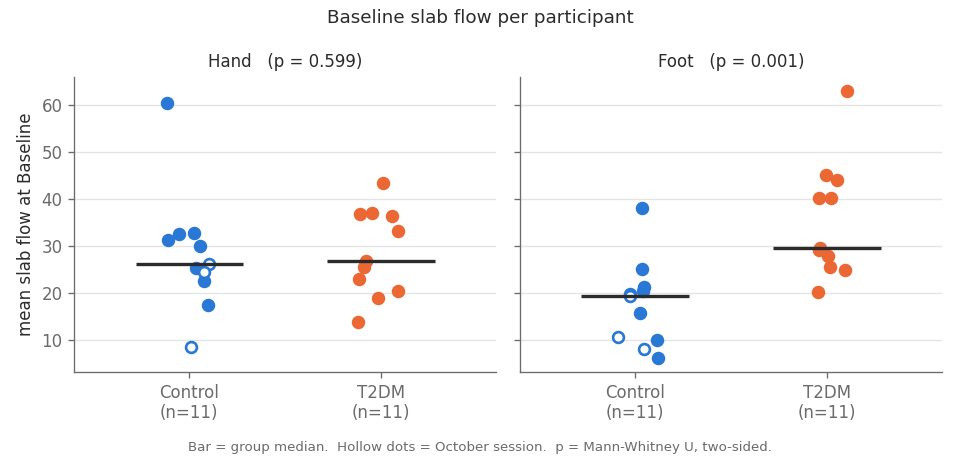
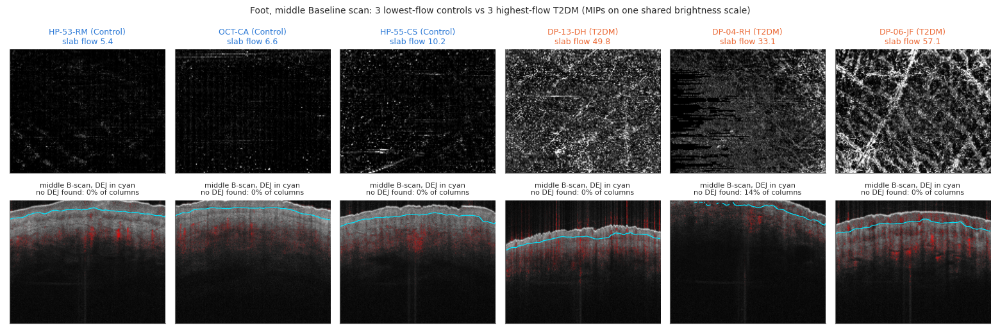
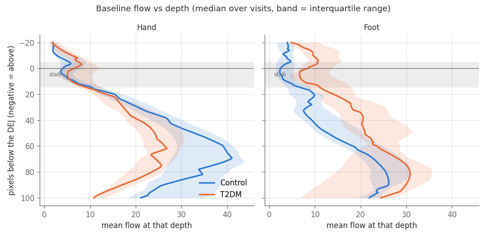
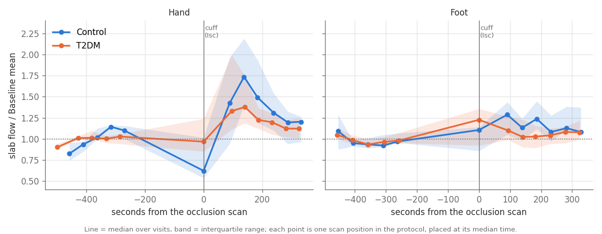
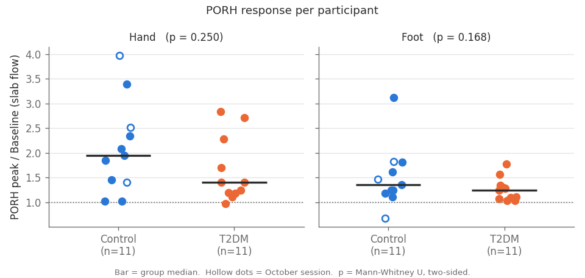
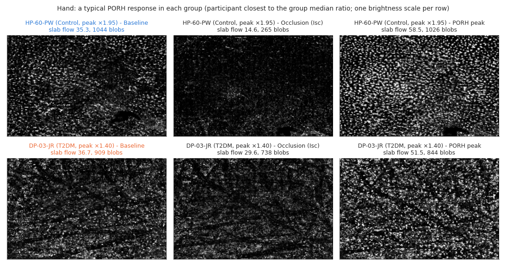

# T2DM vs controls: Baseline flow and PORH response

*Run finished 2026-11-12. Figures made by `src/report_study_groups.py` from the
results in `outputs/porh_time_course/study_groups/slab_-5_15/`.*

## In short

1. **Foot Baseline flow is higher in T2DM than in controls**: median slab flow
   29.7 vs 19.5 (p = 0.001). This is the only clear group difference. It holds
   with the October session removed. However, **2 of the 3 highest T2DM feet have
   image problems**, so it needs a quality check before it goes in the article.
2. **Hands:** Baseline flow is the same in both groups. Controls show a bigger PORH
   rise (×1.95 vs ×1.40), but the difference is **not significant** (p = 0.25).
3. **Feet:** the PORH response is weak in both groups. Foot flow often *rises*
   during occlusion, so the cuff probably doesn't stop flow to the foot, and foot
   PORH can't be used to compare the groups yet.
4. **An unplanned side finding:** deeper in the hand (40–90 px below the DEJ),
   T2DM has less flow than controls (p = 0.018). This was found by looking, not
   planned in advance, so treat it as a lead.

## What was run

| | |
|---|---|
| Participants | 11 T2DM, 11 controls (the article's study groups; mean age 60.5 vs 60.4) |
| Sites | Hand and foot (hallux or instep), one visit per site |
| Scans | 506 (44 visits × about 5 Baseline + 1 occlusion + 6 PORH) |
| Sessions | All T2DM scanned in May 2021; 3 controls (CA, JA, TL) only in October 2020 |
| Measure | Mean flow in the slab from 5 px above to 15 px below the DEJ, plus the blob count |
| Statistics | Mann-Whitney U, two-sided, one value per participant and site. No correction for multiple tests. |

*PORH = post-occlusive reactive hyperaemia: the overshoot in blood flow after the
cuff is released.*

---

## 1. Baseline flow



- **Hand:** the two groups overlap completely (26.9 vs 26.3).
- **Foot:** T2DM is clearly higher (29.7 vs 19.5).
  - Ranked by foot flow, the 7 lowest are all controls, and 6 of the 7 highest are
    T2DM.
  - The blob count agrees: 570 vs 350 (p = 0.003).
  - It is **not the October session**: with the 3 October controls removed it is
    29.7 vs 20.2 (p = 0.004).
  - It is **not where on the foot we scanned**: T2DM is higher on both the hallux
    (31.1 vs 18.3) and the instep (39.8 vs 14.7).
  - It is **not skin thickness**: median epidermis 33 vs 32 px.

**A possible biological explanation:** neuropathy damages the sympathetic nerves
that keep skin vessels constricted. The diabetic foot can therefore run warm with
high resting blood flow, partly through shunting past the capillaries. If the
finding holds, it would be a meaningful result.

### But look at the images behind the extremes



The top row shows the en-face MIPs, all on the same brightness scale. The bottom
row shows the middle B-scan, with the DEJ the model found in cyan.

- **The low controls (RM, CA, CS)** look like genuinely low flow. The tissue and
  DEJ look fine, and flow (red) only appears deeper down.
- **DH (T2DM):** vertical red streaks run through the air *above* the skin. That
  is motion or noise artefact, and it adds "flow" to the slab.
- **RH (T2DM):** the skin surface is cut off at the top of the image, and the DEJ
  is missing in 14% of columns. The dark bands on the left of the MIP come from
  that.
- **JF (T2DM):** the MIP shows a network of larger vessels rather than loop dots.
  Either larger vessels sit very close to the surface (which could be real
  biology), or the slab reaches the deeper plexus.

**So the foot result is promising but not yet safe.** Before trusting it we need a
scan-quality check (artefact above the skin, cut-off surface, missing DEJ), and to
re-test the difference with poor scans removed.

### Flow vs depth



Each curve shows the average flow at each depth relative to the DEJ. The grey band
is the slab.

- **Foot:** T2DM has more flow at every depth from the slab down to about 60 px,
  not just in the slab. That fits either a genuine whole-skin increase in blood
  flow or an image-wide effect such as artefact.
- **Hand:** the groups are the same near the surface. Deeper (40–90 px, the
  vessel plexus), **controls have much more flow**: 35.8 vs 23.6 (p = 0.018; May
  only p = 0.009). This was spotted in the figure, not planned, so treat it as a
  lead.

---

## 2. The PORH response



Each visit's flow is divided by its own Baseline mean, so 1.0 = normal. The line is
the median over participants; the band is the middle 50%.

- **Hand, controls:** the textbook curve. Flow falls to about 0.6 during occlusion,
  overshoots to about 1.75 about 140 s later, then settles.
- **Hand, T2DM:** the same shape but flatter. The occlusion dip is small (median
  0.93 vs 0.62) and the peak lower.
  - Only 3 of 11 T2DM hands drop below 0.8 during occlusion, against 7 of 11
    controls.
  - Neither difference is significant (p = 0.26 for the dip).
- **Foot:** almost no curve in either group, and flow goes *up* during occlusion.
  The cuff probably doesn't stop flow to the foot.



The peak ratio is the highest PORH scan divided by the Baseline mean.

- **Hand:** controls ×1.95, T2DM ×1.40 (p = 0.25). The direction fits weaker
  vessel reactivity in diabetes, but 11 per group is too few to tell it from chance.
- **Foot:** ×1.35 vs ×1.24 (p = 0.17). The blob count gives p = 0.045, but with
  this many tests and a doubtful occlusion it shouldn't be trusted.

### What it looks like



These are the participants closest to their group's median response.

- **Control PW:** the dot pattern (capillary loops) almost disappears during
  occlusion and comes back brighter after release.
- **T2DM JR:** changes much less across the three phases.

---

## All numbers

Medians per group. p-values are T2DM vs Control, for all participants and with the
October visits removed (May only: 11 T2DM vs 8 controls).

| Measure | Site | T2DM | Control | p (all) | p (May only) |
|---|---|---|---|---|---|
| Slab flow, Baseline | Hand | 26.9 | 26.3 | 0.60 | 0.97 |
| | Foot | **29.7** | **19.5** | **0.001** | **0.004** |
| Blobs, Baseline | Hand | 682 | 610 | 0.56 | 0.97 |
| | Foot | **570** | **350** | **0.003** | **0.016** |
| Slab flow, PORH peak ratio | Hand | 1.40 | 1.95 | 0.25 | 0.48 |
| | Foot | 1.24 | 1.35 | 0.17 | 0.15 |
| Blobs, PORH peak ratio | Hand | 1.37 | 1.67 | 0.95 | 0.90 |
| | Foot | 1.09 | 1.39 | 0.045 | 0.026 |
| Slab flow during occlusion / Baseline | Hand | 0.93 | 0.62 | 0.26 | 0.35 |
| | Foot | 1.23 | 1.11 | 0.29 | 0.72 |
| Time of PORH peak (s after occlusion scan) | Hand | 111 | 103 | 0.51 | 0.84 |
| | Foot | 149 | 184 | 0.84 | 0.84 |
| Deep flow, 40–90 px below DEJ (Baseline) | Hand | **23.6** | **35.8** | **0.018** | **0.009** |
| | Foot | 23.7 | 19.2 | 0.39 | 0.84 |
| Epidermis thickness (px) | Hand | 29 | 29 | 0.60 | |
| | Foot | 33 | 32 | 0.90 | |

How often the measures detect a response:

| | Hand T2DM | Hand Control | Foot T2DM | Foot Control |
|---|---|---|---|---|
| PORH peak > 2 SD above Baseline (slab flow) | 9 / 11 | 9 / 11 | 5 / 11 | 6 / 11 |
| Flow lower during occlusion than at Baseline | 7 / 11 | 8 / 11 | 4 / 11 | 5 / 11 |

Overall, slab flow detects a PORH response in 29 of 44 visits and the blob count in
20 of 44, so slab flow stays the main measure.

**On the p-values:** about 20 tests were run on 22 people. With a strict correction
(0.05 / 20 = 0.0025), only the foot Baseline slab flow (p = 0.001) clearly passes.

---

## Caveats

- **Scan quality is unchecked.** Motion artefacts and cut-off surfaces affect some
  scans (see the foot figure). No scans have been removed for quality yet.
- **Session confound.** The 3 October-only controls have low flow, so October scans
  may differ. With them removed, the foot Baseline difference and the direction of
  the hand PORH difference both hold. Hand Baseline flow flips slightly (T2DM 26.9
  vs controls 30.7), but it is far from significant either way.
- **Foot occlusion.** If the cuff doesn't stop flow to the foot, foot PORH measures
  something other than reactive hyperaemia.
- **The flow signal is the scanner's red display overlay,** not the raw OCTA data.
- **The segmentation model** was trained with patient leakage and still needs
  retraining.
- **The PORH peak may be missed.** The first scan after release comes about 90 s
  after the occlusion scan.
- **Small groups:** 11 per group can only detect large differences.

## Next steps

1. **Scan-quality check:** flag flow above the skin surface, cut-off surfaces and
   missing DEJ, then re-test the foot Baseline difference without the poor scans.
   The flow-vs-depth profile is a natural starting point.
2. **Find out where the cuff was placed on the foot,** and whether skin or room
   temperature was recorded (temperature strongly affects resting foot flow).
3. **Plan a test for the deep hand-flow difference** before treating it as a
   result.
4. Ask why `DP-11-DC` is in neither group (adding one more diabetic would help).

## Reproduce

```bash
# the analysis (about 1.5 h on the drive; resumes from cache)
python src/compare_phases.py --study-groups

# these figures and numbers (seconds; no drive needed)
python src/report_study_groups.py
```

The full outputs, including the per-scan and per-visit tables, a per-visit MIP
sheet and every individual time course, are in
`outputs/porh_time_course/study_groups/slab_-5_15/`.
